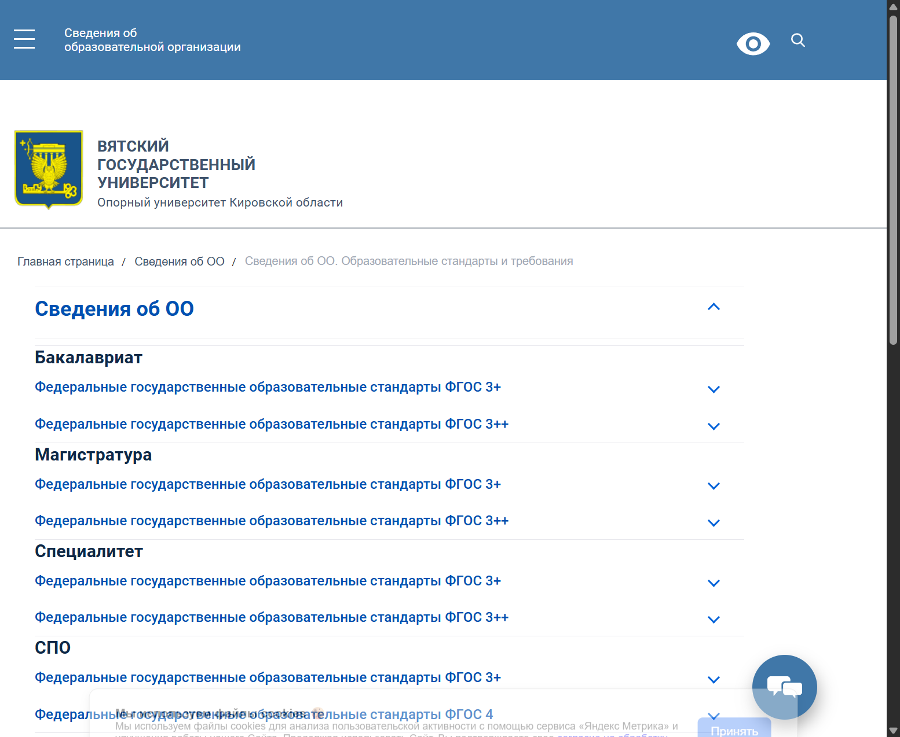
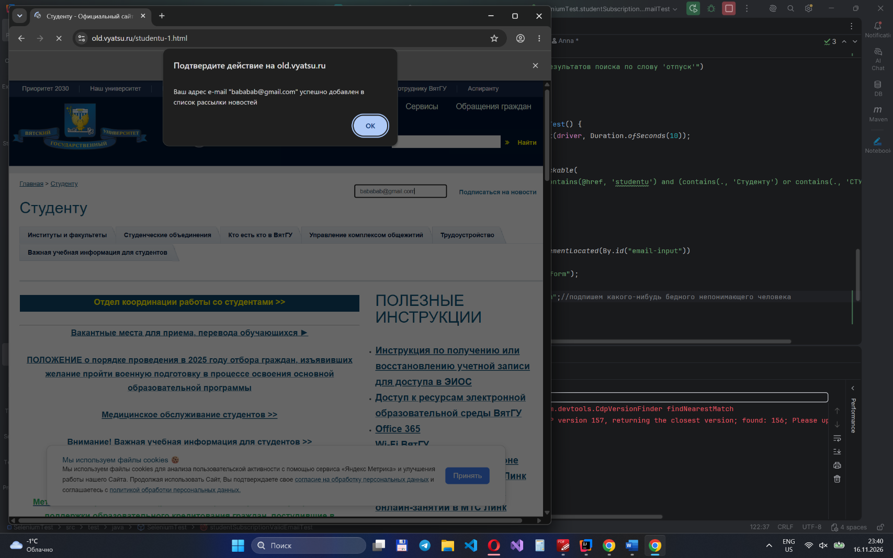
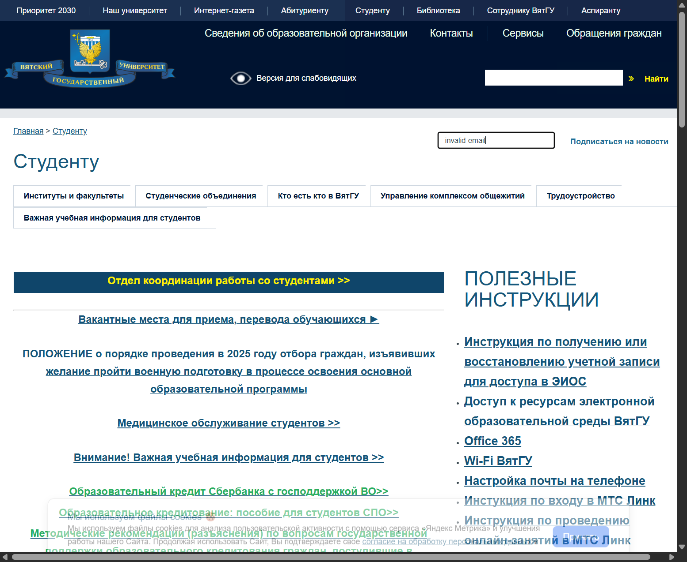
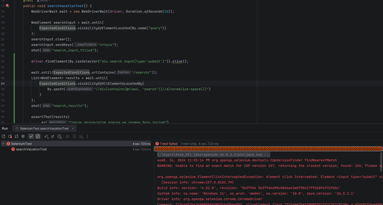

# Отчет по лабораторной работе 4

Автоматизированные тесты на сайте [old.vyatsu.ru](https://old.vyatsu.ru)

## Стек технологий

* **Java 17**
* **Maven**
* **Selenium WebDriver 4.52.0**
* **JUnit 4.13.2**
* **AssertJ 3.27.7**

---

## Результаты выполнения тестовых сценариев

### 1. Базовая проверка открытия сайта и заголовка (`openSiteTest`, `titleTest`)
| Открытие главной страницы | Проверка заголовка |
| :---: | :---: |
|  |  |

---

### 2. Демонстрация падающего теста (`titleFailDemo`)

---

### 3. Сценарий 1: Навигация по меню в раздел «Образовательные стандарты»

| Раскрытие меню через Actions | Переход на страницу стандартов |
| :---: | :---: |
|  |  |

---

### 4. Сценарий 2: Поиск по сайту

| Ввод поискового запроса | Выдача результатов поиска |
| :---: | :---: |
|  |  |

---

### 5. Сценарий 3: Подписка на новости в разделе «Студенту»
#### Скриншоты шагов подписки

| Ввод корректного e-mail | Ответ сайта (корректный e-mail) |
| :---: | :---: |
|  |  |

| Ввод некорректного e-mail | Ответ сайта (некорректный e-mail) |
| :---: | :---: |
|  |  |

---

## Разбор возникших ошибок и их исправление

### 1. Перекрытие кнопки поиска (`ElementClickInterceptedException`)

В сценарии 2 при попытке выполнить физический клик по кнопке отправки формы, 
так как текстовое поле `<input type="text" name="query">` визуально накладывается поверх координат кнопки «Найти».
`.click()` был заменен на отправку формы нажатием клавиши Enter.

