# Отчет по лабораторной работе 4

Автоматизированные тесты на сайте [old.vyatsu.ru](https://old.vyatsu.ru) и [otzovik.com](https://otzovik.com)

## Стек технологий

* **Java 17**
* **Maven**
* **Selenium WebDriver 4.52.0**
* **JUnit 4.13.2**
* **AssertJ 3.27.7**

---

## Задача 1: Результаты выполнения тестовых сценариев
### 1. Базовая проверка открытия сайта и заголовка (`openSiteTest`, `titleTest`)
| Открытие главной страницы | Проверка заголовка |
| :---: | :---: |
| 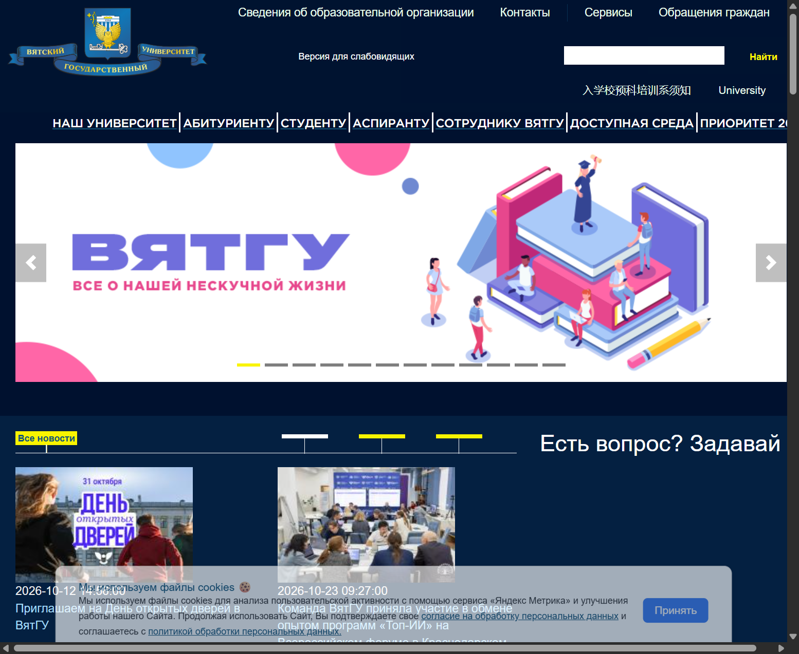 | 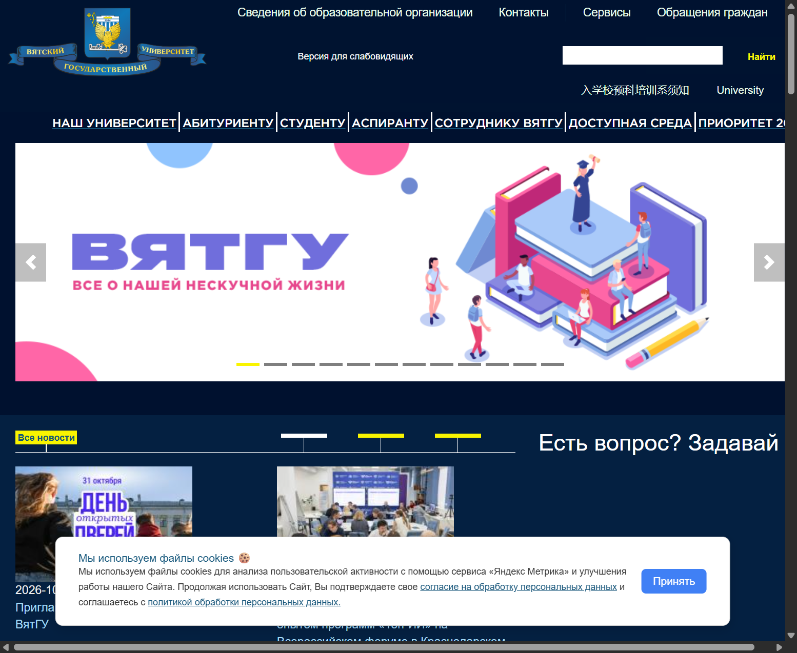 |

---

### 2. Демонстрация падающего теста (`titleFailDemo`)

---

### 3. Сценарий 1: Навигация по меню в раздел «Образовательные стандарты»

| Раскрытие меню через Actions | Переход на страницу стандартов |
| :---: | :---: |
| 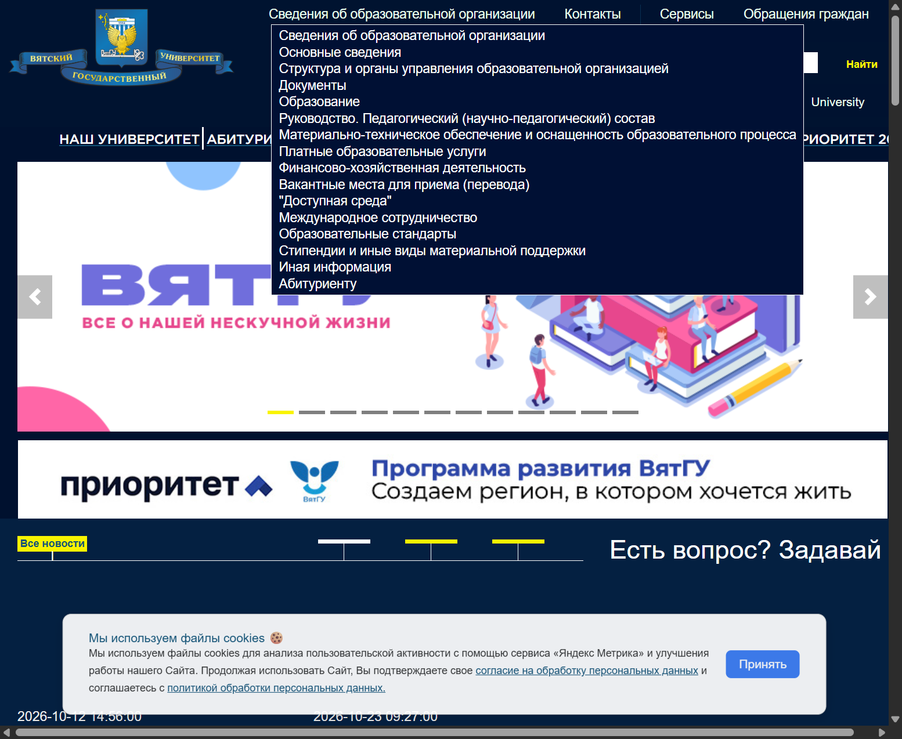 |  |

---

### 4. Сценарий 2: Поиск по сайту

| Ввод поискового запроса | Выдача результатов поиска |
| :---: | :---: |
|  | 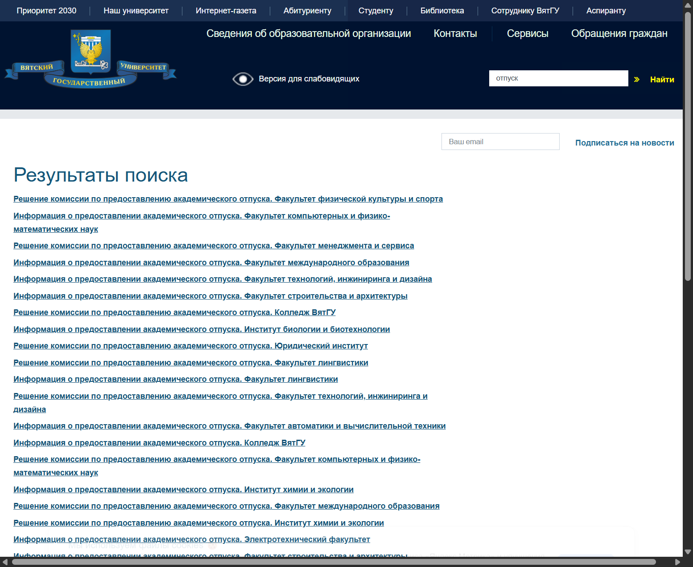 |

---

### 5. Сценарий 3: Подписка на новости в разделе «Студенту»
#### Скриншоты шагов подписки

| Ввод корректного e-mail | Ответ сайта (корректный e-mail) |
| :---: | :---: |
|  |  |

| Ввод некорректного e-mail | Ответ сайта (некорректный e-mail) |
| :---: | :---: |
|  | 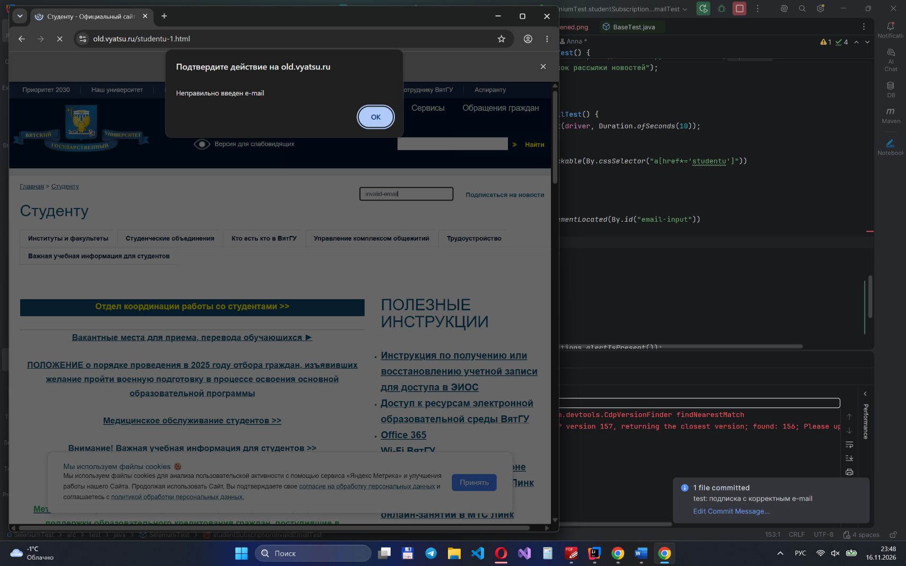 |

---

## Задача 2: Тестирование портала «Отзовик» ([otzovik.com](https://otzovik.com))
### 1. Сценарий 1: Поиск объекта через автодополнение (`searchYandexMetroTest`)
| 1. Ввод запроса «яндекс» | 2. Выбор подсказки «Yandex Metro» | 3. Страница объекта и счётчик отзывов |
| :---: | :---: | :---: |
|  |  | 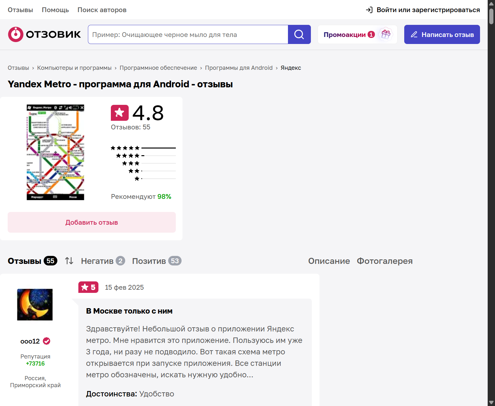 |

---

### 2. Сценарий 2: Проверка валидации формы при создании отзыва (`writeReviewValidationTest`)
| 1. Выбор объекта «Ботанический сад ВятГУ» | 2. Ошибки валидации при предпросмотре |
| :---: | :---: |
| 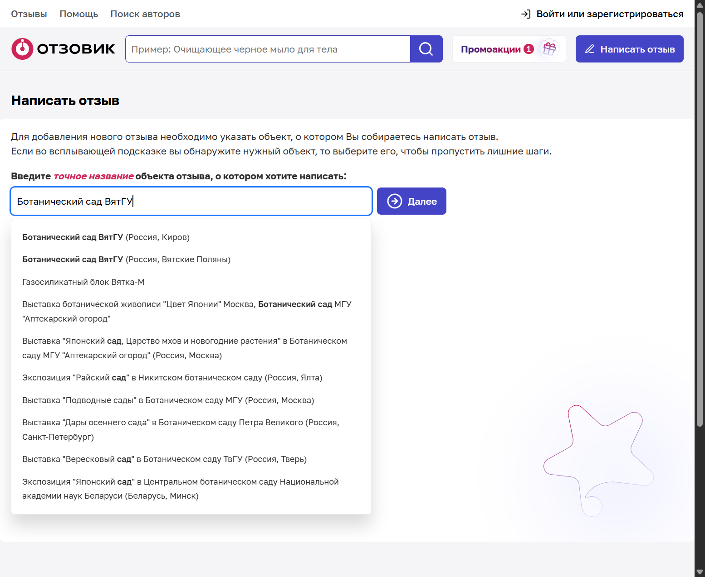 | 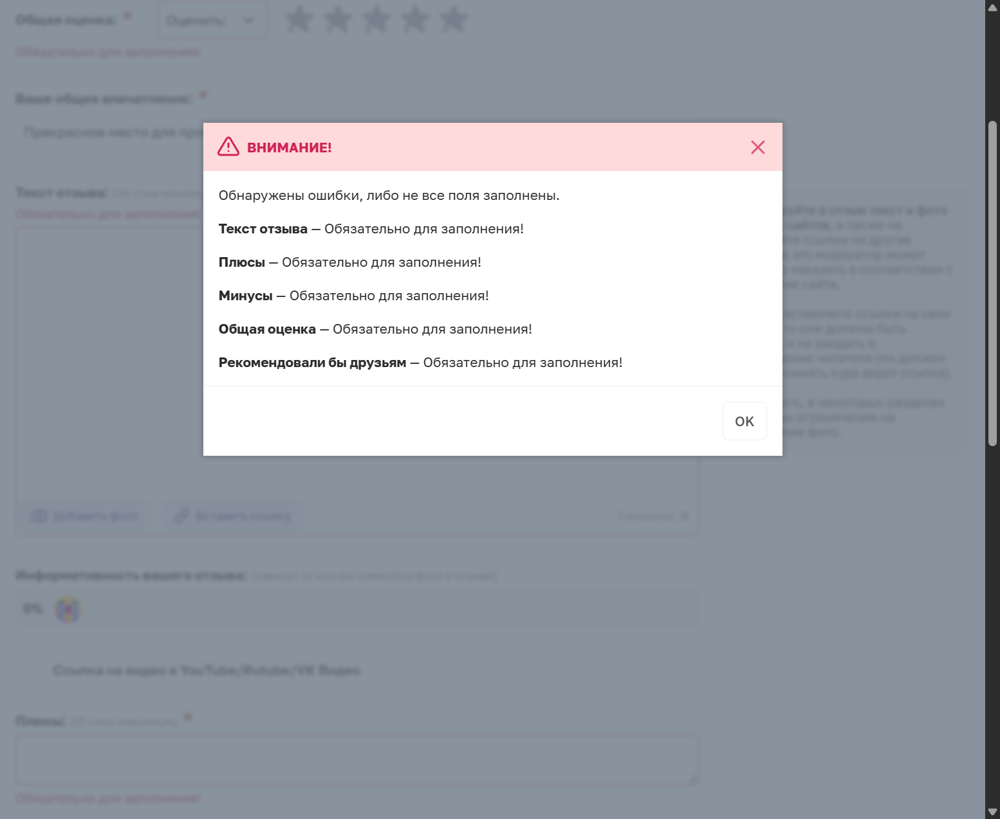 |

---

## Разбор возникших ошибок и их исправление

### 1. Перекрытие кнопки поиска (`ElementClickInterceptedException`)

В сценарии 2 задания 1 при попытке выполнить физический клик по кнопке отправки формы, 
так как текстовое поле `<input type="text" name="query">` визуально накладывается поверх координат кнопки «Найти».
`.click()` был заменен на отправку формы нажатием клавиши Enter.

### 2. Ошибка иерархии в XPath при поиске подсказок (`TimeoutException`)
В сценарии 1 задания 2 (`searchYandexMetroTest`) при попытке найти подсказку `«Yandex Metro»` в выпадающем списке поиска использовался неверный XPath 
`//*[contains(@class, 'popup-obj')]//*[contains(text(), 'Yandex Metro')]`. Конструкция `//*` заставляла Selenium искать нужный текст только во вложенных 
дочерних тегах глубже по дереву, пропуская текст внутри самой ссылки - была произведена замена на `.popup-box`.

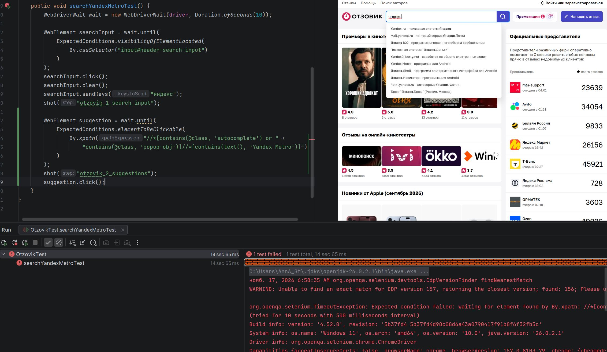

---

### 3. Разбиение текста подсказки тегами выделения `<b>` (`TimeoutException`)

В сценарии 2 задания 2 (`writeReviewValidationTest`) при выборе объекта `«Ботанический сад ВятГУ (Россия, Киров)»`
При поиске по XPath с функцией `contains(text(), 'Ботанический сад')` элемент не находился, так как отзовик оборачивает совпавшую часть запроса в тег `<b>` (например, `<b>Ботанический сад</b> ВятГУ`),
поэтому `text()` заменен на точку `.`, которая собирает весь текстовый контент элемента целиком вместе со всеми вложенными тегами `<b>`.

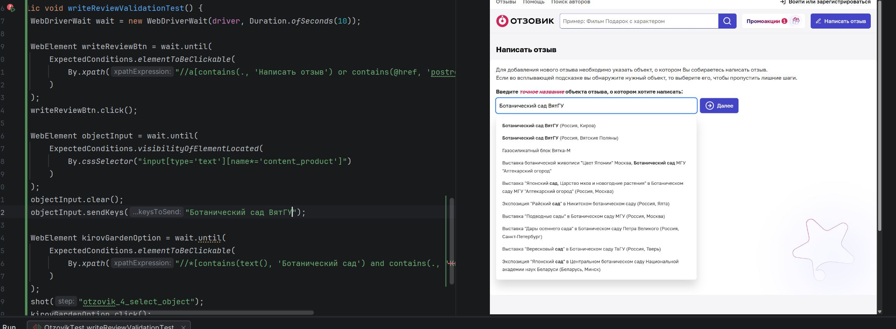

---

### 4. Считывание пустого текста до отрисовки сообщений об ошибках (`AssertionError`)

В сценарии 2 задания 2 (`writeReviewValidationTest`) на финальной проверке `assertThat(errorText).isNotBlank()` после нажатия кнопки «Предпросмотр» поиск элементов 
ошибок через `driver.findElements(...)` выполнялся мгновенно после клика по кнопке, до того как AJAX-валидация успевала отрисовать текст ошибок в DOM. 
В результат попадали пустые или скрытые контейнеры, и переменная `errorText` оставалась пустой строкой `""`.
Добавлено строгое явное ожидание (`wait.until`), которое проверяет одновременно и видимость элемента (`msg.isDisplayed()`), 
и наличие в нем непустого текста, и только после этого собирает все отображаемые сообщения.

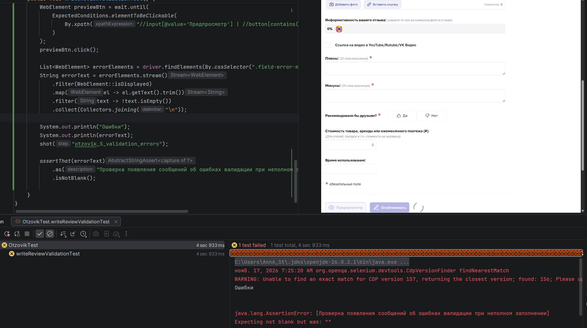

